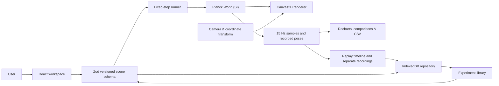

# Technical architecture

`model.ts` defines version 1 scene data and validates references, finite inputs, geometry, and spring frequency. `physics.ts` builds a fresh world from that definition and keeps Planck objects, current forces, and samples in runtime state. Browser animation frames drive a capped accumulator at 60 Hz. They trigger canvas rendering independently.

The editor changes a scene snapshot through one validation path. Mechanical edits build a replacement world before committing the new scene. UI-only changes such as zoom, notes, and playback speed preserve the run. IndexedDB writes resolve after transaction completion. Rename uses a single read/write transaction. Scene saves include the camera and initial conditions. Database version 2 adds a recording store while retaining version 1 scenes. Save Replay stores the historical scene snapshot and recorded poses separately, and creates a library entry if needed. Deleting an experiment removes both records in one transaction.

`coordinates.ts` is the boundary between meters and screen pixels. `render.ts` draws the viewport and template previews. `analysis.ts` computes references, energy and metrics, and exports CSV. The chart panel consumes sampled positions from the engine. Baselines capture the selected body, scene snapshot, and its samples for the current workspace session. Replay reads position, angle, velocity, and acceleration from recorded samples. It renders those poses directly, without advancing or mutating the current Planck world.
